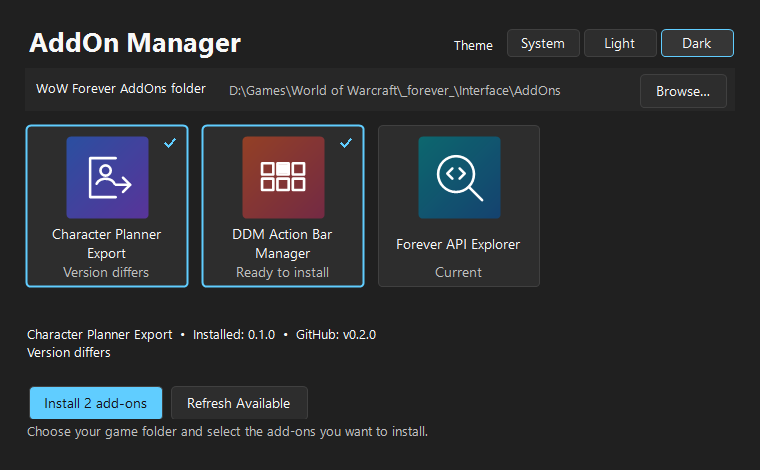
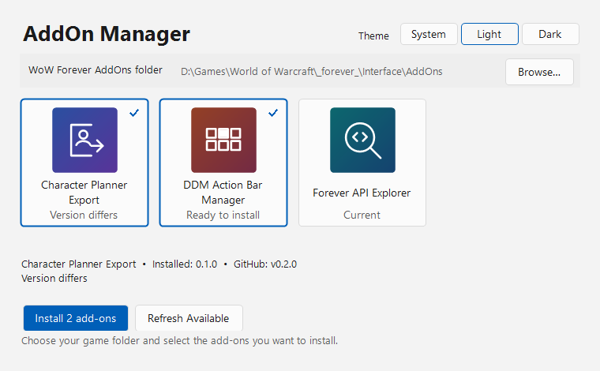

# Dave's Discount Meats AddOn Manager

Part of a set of [WoW: Forever tools](https://github.com/thechainercygnus).

A Windows app for installing and updating World of Warcraft: Forever add-ons from public GitHub releases.

[Download the latest Windows installer](https://github.com/thechainercygnus/DDMAddOnManager/releases/latest)

## Screenshots

Dark and Light modes with two add-ons selected. The folder and versions shown are examples.

## Install or update the manager

1. Open the latest release and download **DDMAddOnManager-Setup.exe** from **Assets**. The installer is unsigned, so Windows may display a SmartScreen warning.
2. Run Setup. It installs the manager for your Windows account and adds it to the Start menu.
3. To upgrade, close the manager and run the newer installer. Setup replaces the existing copy in place.
4. To remove the manager, close it and go to **Settings > Apps > Installed apps**.

The manager checks for a newer stable release at startup. Click **App updates** to check manually. When **Update available** appears, click it to open the release page, download Setup, and close the manager before running it.

If you have a portable ZIP from a local build, extract it and run the manager directly.

## Install and update add-ons

1. Launch the manager. It checks Windows installation records and common folders on local drives. If it finds one WoW Forever installation, it fills in the **WoW Forever AddOns folder** automatically.
2. If the field is empty or points to the wrong copy, click **Browse…**. Choose the World of Warcraft root, its `_forever_` client folder, or the client's `Interface\AddOns` folder. The manager remembers a manually selected folder while it exists.
3. Click each tile you want to install or update. A checkmark indicates that the tile is selected. Click a selected tile again to deselect it.
4. Click **Install N add-ons**. If any selected add-ons will be replaced, the manager shows one confirmation listing them. The install count includes only selected add-ons with downloadable packages.
5. Restart WoW Forever to load the changes.

The manager compares the installed add-on's TOC version with the latest GitHub release tag. **Current** means the versions match. **Version differs** means installing will replace the local copy with the GitHub release. The details beneath the tiles show both versions for the most recently clicked tile. Click **Refresh Available** to check GitHub again.

Install or update while the game is closed. The manager writes into the selected AddOns directory. WoW's SavedVariables are stored separately.

Choose **System**, **Light**, or **Dark** in the header. System follows the Windows app color setting, and the manager remembers your choice.

## Add an add-on from GitHub

Click **Add from GitHub…** and paste an HTTPS link to a public GitHub repository or one of its release pages. The manager uses the latest stable release. If the add-on's installed folder name differs from the repository name, enter the folder name before clicking **Add**. Custom entries are saved for your Windows account and appear alongside the bundled add-ons.

The release must include an uploaded ZIP. The manager looks for a ZIP named after the add-on folder first, then accepts a differently named ZIP if it is the release's only uploaded ZIP. The archive must contain the add-on folder with its matching TOC file, and the TOC version must match the release tag. GitHub's automatically generated source archives are separate from uploaded release assets.

Add the [Questie repository](https://github.com/Questie/Questie) once to install or update both Questie and QuestieDB together. The [standalone QuestieDB repository](https://github.com/Questie/QuestieDB) uses its Forever ZIP. The manager prevents both entries from managing the same folder.

## Build and publish

Use PowerShell 7 on 64-bit Windows.

- Run `.\Build.ps1 -AppOnly` from a standalone checkout to build `dist\DDMAddOnManager-Setup.exe` and the portable ZIP.
- Run `.\Build.ps1` from the manager checkout alongside the add-on projects to also package add-on ZIPs under `dist\release-assets`.
- Run **Build Windows installer** manually from the GitHub Actions tab to upload an installer artifact. Push a stable tag such as `v0.1.0` to publish the versioned installer under GitHub Releases.

## Add-on catalog and release packages

The catalog in [addons.json](addons.json) lists Character Planner Export, DDM Action Bar Manager, Forever API Explorer, and Vendor Deals. Each entry specifies the add-on folder, display name, and GitHub repository.

For each add-on release, set the TOC's `## Version:` to the release version and publish a stable GitHub release with a matching tag, such as `v0.2.0` for TOC version `0.2.0`. Attach a ZIP named `<AddonFolder>.zip` containing `<AddonFolder>/<AddonFolder>.toc`. The manager checks the latest public stable release and downloads that exact asset.

## License

[MIT](LICENSE). World of Warcraft names and game data belong to Blizzard
Entertainment. This project isn't affiliated with or endorsed by Blizzard.
